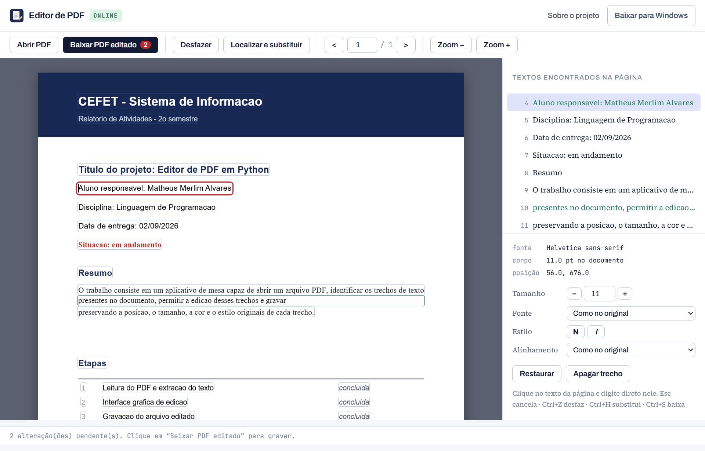
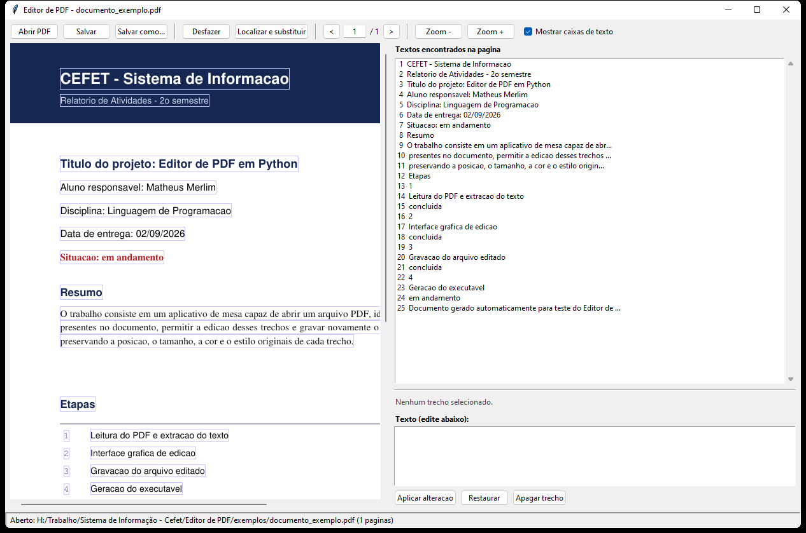

<div align="center">


# Editor de PDF

**Abre um arquivo PDF, identifica o texto que existe dentro dele, permite reescrever esse texto e salva tudo de volta em PDF.**
Funciona direto no navegador, sem instalar nada, ou como programa de mesa para Windows.

[](https://www.python.org/)
[](https://pymupdf.readthedocs.io/)
[](https://mozilla.github.io/pdf.js/)
[](LICENSE)
[](https://github.com/matheusmerlim1/editor-pdf/actions/workflows/build.yml)

[**Editar um PDF online**](https://matheusmerlim1.github.io/editor-pdf/editor.html) ·
[Baixar para Windows](https://github.com/matheusmerlim1/editor-pdf/releases/latest) ·
[Página do projeto](https://matheusmerlim1.github.io/editor-pdf/) ·
[Como funciona](#como-funciona)



</div>

---

## Duas versões, o mesmo editor

|  | No navegador | Programa de mesa |
|---|---|---|
| **Instalação** | nenhuma | baixar 53 MB |
| **Onde roda** | qualquer sistema com navegador | Windows |
| **Texto antigo** | coberto com a cor do fundo | removido do arquivo |
| **Cor e fundo** | lidos dos pixels da página | lidos da estrutura do PDF |
| **Privacidade** | tudo no seu navegador | tudo na sua máquina |

A versão online resolve o caso comum — corrigir um nome, uma data, um valor — sem instalar nada.
A versão de mesa é a indicada quando o texto antigo precisa **sair mesmo** do arquivo, e não só
ficar escondido embaixo de um retângulo.

## O que ele faz

| Recurso | Descrição |
|---|---|
| **Abrir PDF** | Carrega o arquivo e renderiza as páginas na tela (a versão de mesa também abre PDFs com senha). |
| **Identificar o texto** | Extrai todos os trechos de texto da página, com posição, fonte, corpo e cor. |
| **Editar** | Clique no texto na própria página (ou escolha na lista lateral) e digite o novo conteúdo. |
| **Localizar e substituir** | Troca uma palavra ou frase em uma página ou no documento inteiro de uma só vez. |
| **Apagar trecho** | Tira um texto da página. |
| **Desfazer** | `Ctrl+Z` volta atrás (25 níveis na versão de mesa). |
| **Salvar em PDF** | O resultado é um PDF comum, que abre em qualquer leitor. |

Atalhos: `Ctrl+O` abrir · `Ctrl+S` salvar/baixar · `Ctrl+Z` desfazer · `Ctrl+H` localizar e substituir.

## Como usar

1. Abra o editor ([online](https://matheusmerlim1.github.io/editor-pdf/editor.html) ou o programa) e escolha o arquivo PDF.
2. Os trechos de texto reconhecidos aparecem contornados na página e listados à direita.
3. Clique no trecho que deseja alterar — ele fica marcado em vermelho e o texto vai para a caixa de edição.
4. Digite o novo texto e clique em **Aplicar**. A página é atualizada na hora.
5. Salve (ou baixe) o PDF editado.

## Instalação

### Opção 1 — online, sem instalar nada

Acesse **[matheusmerlim1.github.io/editor-pdf/editor.html](https://matheusmerlim1.github.io/editor-pdf/editor.html)**.
O PDF é lido e gravado pelo próprio navegador: nenhum arquivo é enviado para servidor algum.

### Opção 2 — executável para Windows

Baixe o `EditorPDF.exe` em **[Releases](https://github.com/matheusmerlim1/editor-pdf/releases/latest)** e execute
com dois cliques. É um arquivo único e portátil; também é possível arrastar um PDF sobre ele para abrir direto.



### Opção 3 — a partir do código-fonte

```bash
git clone https://github.com/matheusmerlim1/editor-pdf.git
cd editor-pdf
pip install -r requirements.txt
python editor_pdf.py
```

Requer **Python 3.9 ou superior**. No Linux, o Tkinter pode precisar ser instalado à parte (`sudo apt install python3-tk`).

Para gerar o executável: `build_exe.bat` (ou o comando dentro dele). O resultado fica em `dist/EditorPDF.exe`.

## Como funciona

O PDF não guarda "parágrafos editáveis": ele guarda instruções de desenho que posicionam cada grupo de
caracteres em uma coordenada da página. Por isso a edição acontece em três passos — os mesmos nas duas versões,
mudando apenas a biblioteca que faz o trabalho:

```
                       programa de mesa (PyMuPDF)        navegador (pdf.js + pdf-lib)
                       ──────────────────────────        ────────────────────────────
1. LEITURA             page.get_text("dict")             page.getTextContent()
   texto, caixa, linha-base, fonte, corpo e cor de cada trecho

2. SUBSTITUIÇÃO        add_redact_annot(caixa)           drawRectangle(caixa, cor do fundo)
   apaga / cobre       apply_redactions()                 ↑ cor amostrada dos pixels da página
   escreve por cima    insert_text(origem, ...)          drawText(origem, ...)

3. GRAVAÇÃO            doc.save(destino)                 doc.save() → download
```

**O tamanho da letra é sempre preservado**: o corpo em pontos do trecho original é o mesmo usado no
texto novo, aconteça o que acontecer. Se o texto novo for mais comprido, ele avança para a direita — e,
quando passa da margem da página, o editor avisa na barra de estado em vez de encolher a fonte.

**O espaçamento entre as palavras também**. Em uma linha justificada, o PDF espalha as palavras com
espaço extra para preencher a medida; escrever o texto novo com o espaçamento natural da fonte faria a
linha encolher e deixar de alcançar a margem. O editor mede a largura que o trecho tinha e devolve esse
excesso pelo operador `Tw` — o mesmo recurso que o documento original usava — então a linha mantém a
largura e continua sendo um único trecho para edições seguintes.

Já a **fonte** nem sempre está embutida no arquivo, então o texto novo é reescrito com a fonte
**base-14** equivalente (Helvetica, Times ou Courier, nas variações normal/negrito/itálico), escolhida
pelo nome e pelos atributos da fonte original. O estilo — sem serifa, com serifa, monoespaçada, negrito,
itálico — é mantido; o desenho exato da letra é o da fonte equivalente.

Arquivos principais: [`editor_pdf.py`](editor_pdf.py) (`substituir_trechos()`) e
[`docs/editor.js`](docs/editor.js) (`gerarBytesEditados()`).

## Limitações conhecidas

- **PDFs digitalizados** (somente imagem) não têm texto para identificar; seria necessário OCR. Os dois editores avisam quando isso acontece.
- Na **versão online** o texto antigo é coberto, e não apagado: ele continua dentro do arquivo. Para retirá-lo de verdade, use a versão de mesa.
- A edição é feita por trecho (span), não por parágrafo: um texto muito maior que o original não reorganiza a quebra de linha sozinho. Como o tamanho da letra é preservado, o que passar da margem fica fora da área visível da página — o editor avisa quando isso acontece.
- O texto novo usa a fonte base-14 equivalente, então uma fonte muito característica (Calibri, Georgia, Consolas...) vira a correspondente Helvetica, Times ou Courier, no mesmo tamanho e estilo.
- Caracteres fora do conjunto latino-1 (grego, cirílico) não são suportados pelas fontes base-14. Travessões e aspas curvas são convertidos automaticamente.

## Estrutura do projeto

```
editor-pdf/
├── editor_pdf.py              programa de mesa (Tkinter + PyMuPDF)
├── requirements.txt           dependências da versão de mesa
├── build_exe.bat              gera o dist/EditorPDF.exe
├── docs/                      página do projeto e editor online (GitHub Pages)
│   ├── index.html             página de apresentação
│   ├── editor.html            interface do editor online
│   ├── editor.js              leitura, edição e gravação do PDF no navegador
│   └── exemplo.js             documento de exemplo embutido
├── testes/teste_edicao.py     testes automatizados do núcleo de edição
├── exemplos/gerar_exemplo.py  cria um PDF de teste
├── assets/                    ícone e capturas de tela
└── .github/workflows/         compilação automática do executável
```

## Publicando a página no GitHub Pages

Depois de enviar o repositório, em **Settings → Pages** escolha *Deploy from a branch*,
branch `main` e pasta `/docs`. A página fica em `https://matheusmerlim1.github.io/editor-pdf/`
e o editor em `.../editor.html`.

## Tecnologias

**Versão de mesa:** [PyMuPDF](https://pymupdf.readthedocs.io/) · [Tkinter](https://docs.python.org/3/library/tkinter.html) · [Pillow](https://python-pillow.org/) · [PyInstaller](https://pyinstaller.org/)
**Versão online:** [pdf.js](https://mozilla.github.io/pdf.js/) (ler e desenhar) · [pdf-lib](https://pdf-lib.js.org/) (gravar)

## Licença

Distribuído sob a licença [MIT](LICENSE).

---

<div align="center">
Trabalho da disciplina de Sistema de Informação — CEFET
</div>
